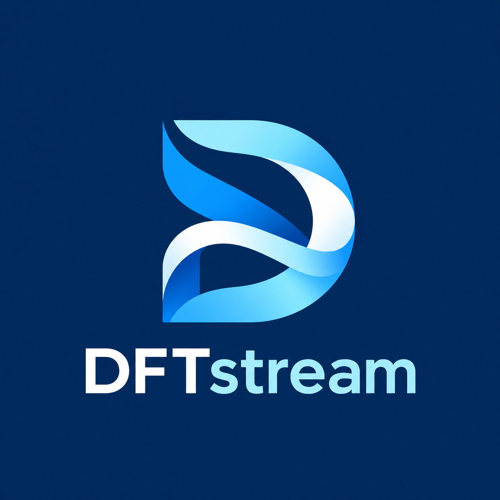
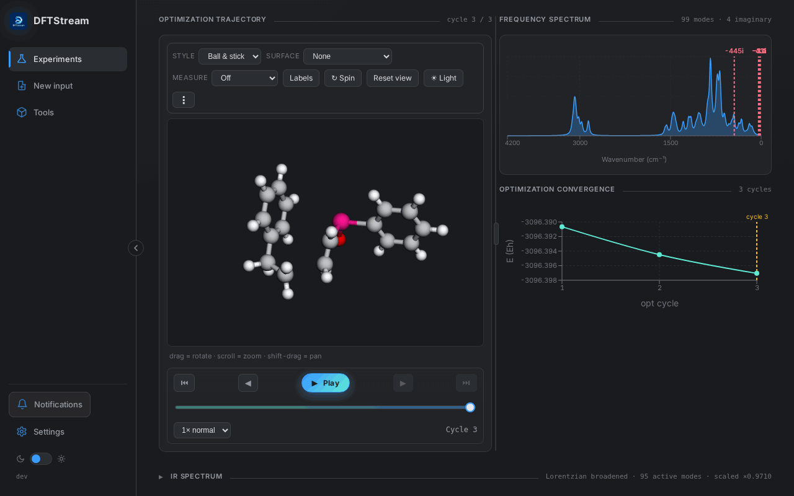
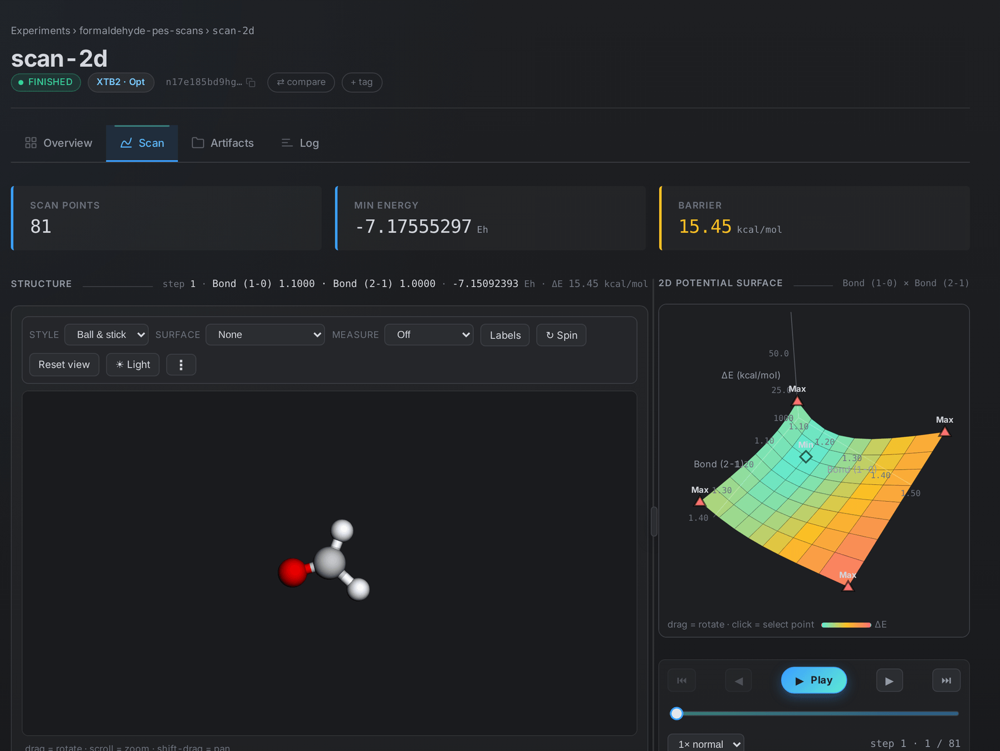
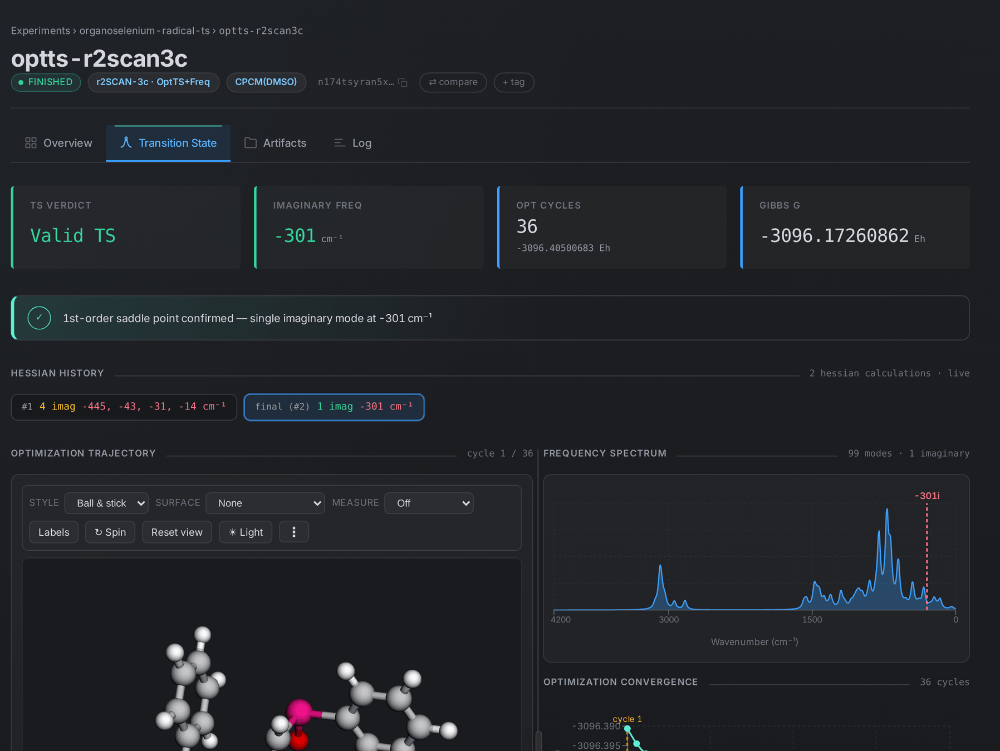
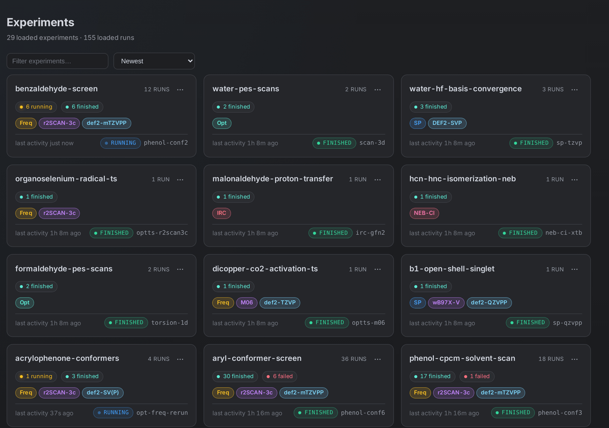
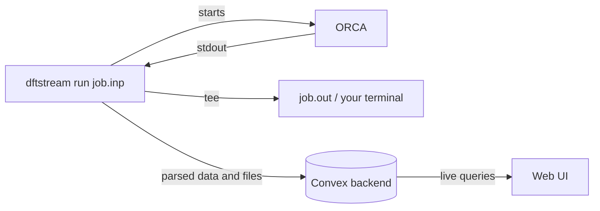

<p align="center">
  
</p>

<h1 align="center">DFTStream</h1>

<p align="center">
  A free, open-source web UI and experiment tracker for ORCA quantum-chemistry calculations.
</p>

<p align="center">
  <a href="#install">Install</a> ·
  <a href="#quick-start">Quick start</a> ·
  <a href="docs/usage.md">Usage</a> ·
  <a href="docs/cli.md">CLI</a>
</p>

> [!NOTE]
> DFTStream is an independent project. It is not affiliated with, endorsed by
> or supported by the ORCA developers, FACCTs or the Max Planck Institute for
> Coal Research. **It does not include ORCA.** You need your own ORCA
> installation, available from the [official ORCA page](https://www.faccts.de/orca/).

<p align="center">
  
</p>

DFTStream wraps an ORCA run and records it as it happens: status, energies,
convergence, geometries, frequencies, thermochemistry and output files. You
follow the job in the browser while it runs, and every run stays searchable
afterwards. ORCA's output and files are left exactly as they are.

```bash
orca water.inp > water.out                          # before
dftstream run water.inp --exp solvation > water.out # after
```

<table>
  <tr>
    <td width="50%"></td>
    <td width="50%"></td>
  </tr>
  <tr>
    <td colspan="2"></td>
  </tr>
</table>

## Install

The easiest way is to let a coding agent do it. In a clone of this repository,
ask Claude Code, Codex or Cursor: *"Set up DFTStream by following
docs/setup-with-agent.md."* It finds ORCA, installs everything into your home
directory, starts the backend and the UI, and checks the result.

To install by hand you need `git`, Go 1.26+ and [Bun](https://bun.sh) (the
installer offers to install Bun). On Linux, the local backend needs glibc 2.35
or newer (Ubuntu 22.04, Debian 12 or later).

```bash
git clone https://github.com/nkls-ai/dftstream.git
cd dftstream
bash scripts/install.sh --method source --mode local \
  --repo "$PWD" --ref "$(git rev-parse --abbrev-ref HEAD)"
```

This puts `dftstream` and `dftstream-db` in `~/.local/bin` (add it to your
`PATH`). Nothing needs root.

## Quick start

```bash
dftstream-db                                  # start the local backend, leave it running
export DFTSTREAM_ORCA=/path/to/orca
dftstream run job.inp --exp project-a > job.out
dftstream ui                                  # open http://127.0.0.1:3000
```

Import calculations you already have, laid out as `<root>/<experiment>/<run>/*.out`:

```bash
dftstream import-experiments ~/calculations
```

## Documentation

| Page | Contents |
| --- | --- |
| [Usage](docs/usage.md) | experiments and runs, job types, verdicts, the TS workflow, common ORCA failures |
| [CLI](docs/cli.md) | every command and flag |
| [Clusters](docs/clusters.md) | SLURM submission, offline compute nodes |
| [Running a backend](docs/operations.md) | local, Docker and cloud backends, configuration, upgrades, backups |
| [Multi-user auth](docs/auth.md) | organizations, roles, CLI login, machine tokens |
| [Setup with an agent](docs/setup-with-agent.md) | step-by-step install for coding agents |
| [Development](docs/development.md) | architecture, building, tests, releases |

## How it works



The wrapper (`wrapper/`, Go) starts ORCA, parses its output as it streams and
sends what it finds to the backend. The backend (`db/`,
[Convex](https://convex.dev)) runs locally, in Docker or in the cloud. The UI
(`ui/`, React) is built into the binary and served by `dftstream ui`.

Auth is off by default, so anyone who can reach the backend port can read and
change every run. The local backend only listens on `127.0.0.1`. Before sharing
a backend beyond a trusted network, turn on [multi-user auth](docs/auth.md).

## License

[MIT](LICENSE). Built with Go, React, Bun, Convex, Recharts and 3Dmol.js.
